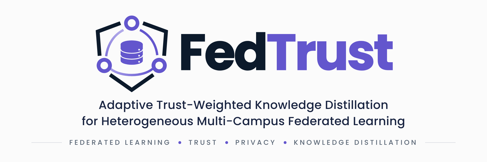
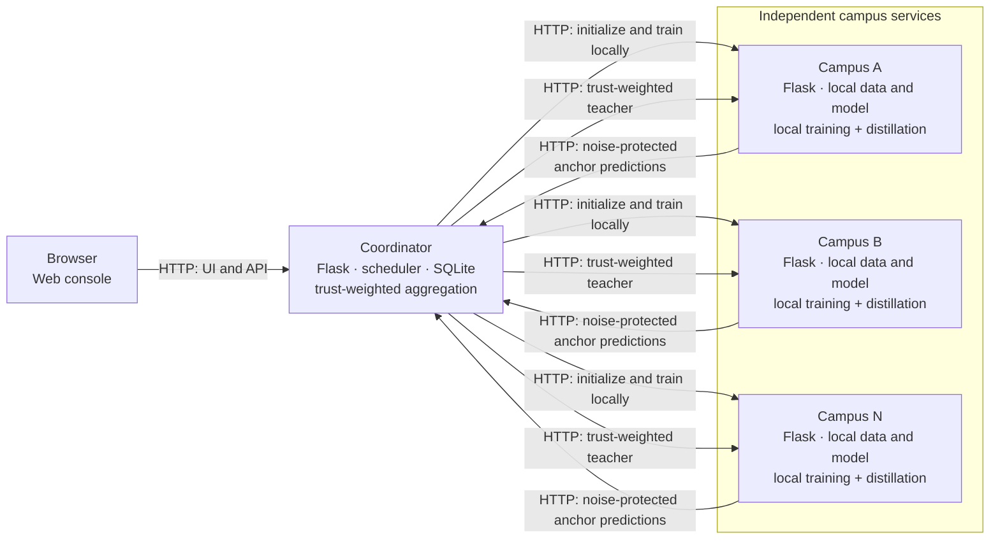

<div align="center">
  

  <h1>FedTrust</h1>
  <p><strong>Adaptive Trust-Weighted Knowledge Distillation for Heterogeneous Multi-Campus Federated Learning</strong></p>
  <p>A Python prototype for coordinating independent campus models without exchanging model weights or private training records over the federation API.</p>

  <p>
    <a href="https://www.python.org/"></a>
    <a href="https://flask.palletsprojects.com/"></a>
    <a href="https://pytorch.org/"></a>
    <a href="https://sqlite.org/"></a>
  </p>
</div>

## Overview

FedTrust is an experimental federated-learning system for image classification across simulated campuses. Each campus runs an independent Flask service, loads its data locally, and trains its own PyTorch model. A Flask coordinator manages experiments and combines campus predictions on a shared anchor set to create a teacher for local knowledge distillation.

The federation exchanges prediction arrays over HTTP—not model weights or training records. Each service loads the configured dataset locally to derive its data splits. The coordinator also loads the dataset to score the teacher against anchor labels; those labels are not sent to campuses.

## Key features

| Federated workflow | Trust and distillation | Experiments and analysis |
|---|---|---|
| Independent campus services with heterogeneous MLP, CNN, and linear models | Trust-weighted teacher from campus predictions, with adaptive or fixed local distillation | Queued experiments, grid studies, cancellation, comparisons, and CSV exports |
| Deterministic train/test/anchor splits and Dirichlet label-skew partitions | Optional Gaussian noise on released prediction vectors, with per-run privacy accounting | Live coordinator and campus status pages with experiment charts |
| Local multi-process and Docker Compose startup | Uniform federated-distillation and local-only baselines | Headless study scripts and result-figure generation |

## Technology stack

| Area | Technologies |
|---|---|
| Runtime | Python 3.10+ (Python 3.12 in the Docker image) |
| Services and UI | Flask, Jinja templates, JavaScript, CSS, Chart.js |
| Machine learning | PyTorch, NumPy, SciPy, scikit-learn |
| Persistence | SQLite |
| HTTP communication | `requests`, JSON, Base64-encoded NumPy arrays |
| Testing and deployment | pytest, Docker Compose, optional Gunicorn |

## Architecture



In collaborative modes, campuses train locally and return only noise-protected predictions for selected anchor indices. The coordinator derives trust weights, aggregates a teacher, and sends teacher predictions back for campus-side distillation. Campus models can differ; model weights are not averaged. The anchor set is assumed public and identical across campuses.

## Quick start

Requires Python 3.10 or later. CPU execution is supported; a GPU is not required. No formal minimum CPU, memory, or storage sizing is defined.

```powershell
python -m venv .venv
.\.venv\Scripts\Activate.ps1
python -m pip install -r requirements.txt
python scripts/start_cluster.py --campuses 4
```

On macOS or Linux, activate the environment with `source .venv/bin/activate`. To install a smaller CPU-only PyTorch build, follow the [official PyTorch instructions](https://pytorch.org/get-started/locally/).

The startup script runs four campus processes (ports 5001–5004) and the coordinator (port 5000), then registers the campuses. Open [http://127.0.0.1:5000](http://127.0.0.1:5000); press `Ctrl+C` to stop the services.

The bundled `digits` dataset works offline. Selecting `mnist` or `fashion_mnist` uses scikit-learn OpenML fetching and requires network access on the machine loading the data.

### Docker Compose

Copy `.env.example` to `.env`, set a unique `FEDTRUST_TOKEN`, and preferably set `COORDINATOR_ADMIN_PASSWORD` before starting:

```powershell
Copy-Item .env.example .env
# Edit .env to replace the development token and configure the optional password.
docker compose up --build
```

Open [http://localhost:5000](http://localhost:5000). Compose starts one coordinator and four campus containers; campuses register themselves. Docker deployment has not been validated in every environment.

> **Security:** Do not expose a deployment using the default development token. The coordinator UI and most APIs have no admin authentication unless `COORDINATOR_ADMIN_PASSWORD` is set. Use a unique shared token for all campuses and the coordinator; the token is not a substitute for transport encryption.

## Usage

1. Check that campuses are online in **Campuses**.
2. Go to **Experiments → New experiment**, select at least two campuses, and configure the dataset, method, schedule, and privacy options.
3. Queue the run and review round-by-round campus metrics and charts.
4. Use **Studies** to run method, privacy, or non-IID sweeps and compare multiple seeds.
5. Export individual runs or studies as CSV.

The available modes are `trust_adaptive`, `trust_fixed`, `uniform_fd`, and `local_only`. The `local_only` mode is a baseline without collaborative prediction exchange. Headless study commands are documented in the [project guide](docs/PROJECT_GUIDE.md).

## Project structure

| Path | Purpose |
|---|---|
| `campus/` | Campus Flask service and local model lifecycle |
| `common/` | Configuration, data, models, privacy, trust, and serialization |
| `coordinator/` | Coordinator Flask app, scheduler, SQLite layer, UI, and static assets |
| `scripts/` | Local cluster startup, study client, and figure generation |
| `tests/` | Numerical/unit tests and HTTP integration tests |
| `docs/` | Technical report, project guide, documentation index, review paper, and result figures |
| `assets/` | README banner artwork |
| `data/`, `instance/` | Dataset cache and default SQLite database locations, used at runtime |

## API and database

The coordinator API manages campus registration, experiments, comparisons, and studies. Campus APIs expose initialization, local training, prediction release, distillation, and evaluation. The campus API and campus registration use the `X-FedTrust-Token` shared-secret header. See the [API documentation](docs/PROJECT_REPORT.md#17-api-documentation) for routes, payloads, response shapes, and authentication details.

The coordinator creates its SQLite database and tables at startup; there is no separate migration command. The default path is `instance/fedtrust.db`, configurable with `FEDTRUST_DB`. The schema stores registered nodes, studies, experiments, and per-experiment round JSON. Docker Compose mounts a named volume at `/app/instance`. See [Database design in the report](docs/PROJECT_REPORT.md#16-database-design).

<details>
<summary>Environment variables</summary>

The project does not load `.env` files itself. `.env.example` documents values for reference; Docker Compose reads `.env` for interpolation. For direct Python runs, set variables in the process environment.

| Variable | Default or purpose |
|---|---|
| `FEDTRUST_TOKEN` | Shared coordinator/campus API token. If unset, code uses the insecure `fedtrust-dev-token`; set a unique secret outside local demos. |
| `COORDINATOR_ADMIN_PASSWORD` | Optional password for coordinator HTTP Basic authentication. If empty or unset, the coordinator UI and most APIs have no admin authentication. |
| `FEDTRUST_DB` | Coordinator SQLite path; default `instance/fedtrust.db`. |
| `FEDTRUST_DATA_DIR` | Dataset cache/data directory; default `data`. |
| `COORDINATOR_HOST`, `COORDINATOR_PORT` | Coordinator bind address and port; defaults `127.0.0.1` and `5000`. |
| `CAMPUS_NAME`, `CAMPUS_HOST`, `CAMPUS_PORT` | Campus name and bind address/port; defaults `Campus`, `127.0.0.1`, and `5001`. |
| `CAMPUS_PUBLIC_URL`, `COORDINATOR_URL` | Optional campus public URL and coordinator URL; setting the latter enables self-registration. |
| `FEDTRUST_TORCH_THREADS` | PyTorch CPU thread count on each campus; default `1`. |

Use the same `FEDTRUST_TOKEN` on the coordinator and every campus. `COORDINATOR_ADMIN_PASSWORD` protects the coordinator with HTTP Basic authentication; it does not configure user accounts or roles.

</details>

## Testing

```powershell
python -m pytest tests -q
```

`tests/test_common.py` covers configuration, data partitioning, serialization, trust calculations, and privacy math. `tests/test_integration.py` starts real campus HTTP processes and checks coordinator workflows, modes, exports, cancellation, authentication, and failure handling.

## Limitations

- The implementation handles image-shaped classification data only.
- Trust is inferred from prediction entropy; confidently incorrect predictions can still receive high trust.
- The anchor set is assumed public and identical across campuses.
- Prediction perturbation is not DP-SGD and does not provide a record-level guarantee for each training example.
- MNIST and Fashion-MNIST depend on OpenML availability and are not part of the repository's deterministic offline dataset path.
- The scheduler serializes experiments because runs share campus services.

<details>
<summary>Potential research and engineering directions (not implemented)</summary>

Consider record-level privacy where required, trust signals that account for correctness rather than confidence alone, multi-worker scheduling with explicit campus isolation, and automated deployment health checks and supported-environment validation.

</details>

## Documentation

- [Comprehensive technical project report](docs/PROJECT_REPORT.md)
- [Project guide: setup, methods, results, configuration, and API summary](docs/PROJECT_GUIDE.md)
- [Documentation index and example figures](docs/README.md)
- [Project review paper](docs/Project%20review%20paper.pdf)

The repository includes a banner and generated result plots, but no application screenshots. No root-level license file was found.

## Contributing

Contributions should preserve the private-data boundary, keep configuration and API behavior covered by tests, and update the technical report when behavior changes. Run `python -m pytest tests -q` before submitting a change. No repository-specific contribution guide is currently present.
