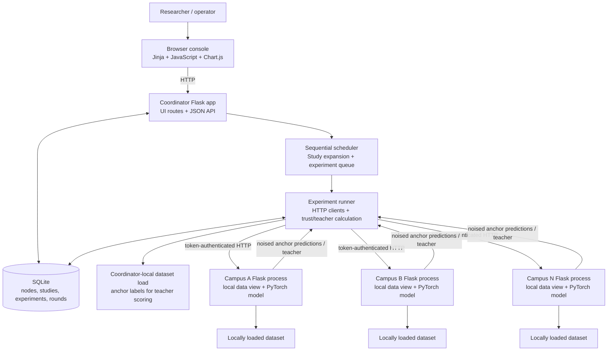
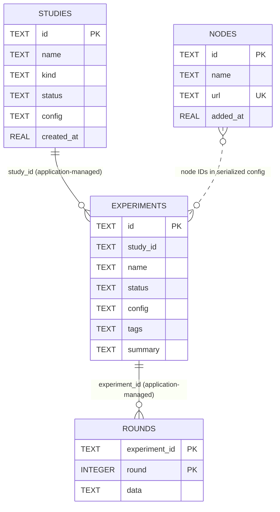

# FedTrust — Technical Project Report

## Contents

1. [Executive Summary](#1-executive-summary)
2. [Project Overview](#2-project-overview)
3. [Problem Statement](#3-problem-statement)
4. [Project Objectives](#4-project-objectives)
5. [Scope of the Project](#5-scope-of-the-project)
6. [Existing System and Limitations](#6-existing-system-and-limitations)
7. [Proposed System](#7-proposed-system)
8. [Technology Stack](#8-technology-stack)
9. [System Requirements](#9-system-requirements)
10. [System Architecture](#10-system-architecture)
11. [Architecture Diagram](#11-architecture-diagram)
12. [Directory Structure](#12-directory-structure)
13. [Module-Wise Explanation](#13-module-wise-explanation)
14. [Detailed Feature Documentation](#14-detailed-feature-documentation)
15. [Application Workflow](#15-application-workflow)
16. [Database Design](#16-database-design)
17. [API Documentation](#17-api-documentation)
18. [Authentication and Authorization](#18-authentication-and-authorization)
19. [External Integrations](#19-external-integrations)
20. [Security Implementation](#20-security-implementation)
21. [Installation and Setup](#21-installation-and-setup)
22. [Environment Configuration](#22-environment-configuration)
23. [Running the Application](#23-running-the-application)
24. [Testing Strategy](#24-testing-strategy)
25. [Known Limitations](#25-known-limitations)
26. [Future Enhancements](#26-future-enhancements)
27. [Conclusion](#27-conclusion)

## 1. Executive Summary

FedTrust is a prototype for coordinating classification experiments among
independent campus services. Each campus service loads a dataset, derives its
own training shard, and trains a local PyTorch model. A Flask coordinator
communicates with campuses over HTTP, persists experiment state in SQLite, and
provides a browser-based experiment console.

Collaborative modes exchange prediction arrays for selected samples from a
shared anchor set. The coordinator perturbs predictions with Gaussian noise,
estimates campus trust, forms a teacher distribution, and sends that teacher
back for local distillation. Model parameters and training examples are not
sent through the federation API. The project also implements local-only and
uniform-weight baselines, repeated-seed studies, result comparison, and CSV
exports.

This report documents behavior found in the repository source, particularly
`campus/`, `common/`, `coordinator/`, `scripts/`, and `tests/`. It does not treat
example figures or prior example measurements as independently reproduced
results.

## 2. Project Overview

| Property | Verified implementation |
|---|---|
| Project | FedTrust |
| Primary use | Prototype and experiment console for trust-weighted federated distillation |
| Services | Flask coordinator and one Flask service per campus |
| Learning | PyTorch classification models |
| Default dataset | scikit-learn `digits` dataset |
| Additional datasets | MNIST and Fashion-MNIST through scikit-learn OpenML fetching |
| Persistence | SQLite database owned by the coordinator |
| Browser UI | Jinja templates, plain JavaScript, CSS, vendored Chart.js |
| Local startup | `scripts/start_cluster.py` |
| Container configuration | `Dockerfile` and `docker-compose.yml` |

The local cluster script starts multiple real service processes, rather than
simulating all campuses inside the coordinator process. The services can also
be started separately and addressed by URL.

## 3. Problem Statement

The implementation targets a setting in which several participants want to
collaborate on image classification while retaining local training data and
using potentially different model architectures. Model-weight averaging
requires compatible parameter layouts; FedTrust instead exchanges predictions
on shared anchor samples and distils a combined teacher into each local model.

The implementation's privacy mechanism protects released prediction vectors
with output perturbation. It is not a complete privacy solution for arbitrary
datasets or a record-level DP-SGD implementation.

## 4. Project Objectives

Objectives evidenced by the implementation are:

- Keep local model instances and local training operations within campus
  processes.
- Coordinate local training and evaluation over HTTP.
- Support heterogeneous image classifiers and non-IID label partitions.
- Construct a teacher from released campus predictions using uniform or
  trust-aware weights.
- Offer fixed and adaptive distillation baselines.
- Add configurable Gaussian noise to released predictions and report a
  round-composition estimate.
- Store experiments and per-round measurements for inspection and export.
- Run configurable study grids over methods, privacy settings, or data skew.

These objectives describe software behavior; they are not claims of a formal
production security certification or general-purpose federated-learning
framework.

## 5. Scope of the Project

### Included

- Image-shaped classification datasets and models.
- Local campus training, prediction, distillation, and test evaluation.
- Shared deterministic splits and Dirichlet label-skew partitioning.
- Coordinator web UI, JSON API, in-process SQLite persistence, and one-worker
  experiment scheduling.
- Prediction-vector noise, trust calculations, study aggregation, and
  communication-byte accounting.
- Development process startup and Docker Compose configuration.

### Not implemented or not established by the repository

- General tabular, text, or arbitrary-shape dataset support.
- Model-weight aggregation, secure aggregation, or encrypted transport.
- DP-SGD or a demonstrated record-level privacy guarantee.
- User accounts, roles, or per-campus credentials.
- A production deployment profile, health-checked Compose orchestration, or
  formal performance/hardware sizing.
- A root `LICENSE` file or repository-specific contribution policy.

## 6. Existing System and Limitations

The codebase is a runnable prototype, not a deployed campus federation. Campus
services use Flask's built-in development server when started by the project
entry points. The default token is a development value, coordinator UI/API
authentication is optional, and the provided container services communicate
over HTTP. These defaults require deliberate hardening before use outside a
trusted demonstration network.

Other implementation constraints are detailed in
[Known Limitations](#25-known-limitations). No external deployment, hardware
capacity, production readiness, or performance benchmark was independently
verified for this report.

## 7. Proposed System

The implemented design has three cooperating layers:

1. **Campus service (`campus/`)** owns the local model and performs local data
   preparation, training, prediction, distillation, and test evaluation.
2. **Coordinator (`coordinator/`)** provides the UI and API, queues work,
   communicates with campus services, calculates teacher/trust values, and
   stores experiment records.
3. **Shared algorithm and data utilities (`common/`)** provide dataset
   partitioning, model construction, privacy calculations, trust math,
   configuration validation, and array serialization.

The coordinator and each campus independently load the configured dataset and
derive deterministic splits. The orchestrator also loads the dataset locally
to obtain anchor labels for teacher-scoring metrics. No dataset samples or
labels are sent in the node HTTP payloads; the network carries selected anchor
indices, model operation parameters, and prediction/teacher arrays.

## 8. Technology Stack

| Layer | Dependencies / implementation | Purpose |
|---|---|---|
| Language/runtime | Python; source syntax requires Python 3.10+; Docker base is Python 3.12 | Application and experiment code |
| HTTP applications | Flask 3.x, `requests` | Coordinator and campus services; outbound node calls |
| ML | PyTorch 2.x | Local classifiers, optimization, and distillation |
| Numerical/data | NumPy, SciPy, scikit-learn | Arrays, Gaussian calculations, datasets, splits, and partitioning |
| Persistence | Python `sqlite3` | Coordinator-managed experiment database |
| UI | Jinja, JavaScript, CSS, Chart.js | Console pages, forms, polling, charts |
| Study figures | Matplotlib (optional dependency) | PNG plots from stored study results |
| Tests | pytest (optional dependency) | Unit and process-level HTTP integration tests |
| Containerization | Dockerfile and Docker Compose | Coordinator plus four configured campus containers |
| Optional serving dependency | Gunicorn | Listed in `requirements.txt`; the provided startup commands do not invoke it |

Declared dependency ranges are in [`requirements.txt`](../requirements.txt).
Chart.js and the Source Sans 3 / Source Serif 4 font files are bundled under
`coordinator/static/`; their accompanying license files are in the same asset
tree.

## 9. System Requirements

### Software

- Python 3.10 or later for direct execution. The Docker image uses Python 3.12.
- Packages in `requirements.txt`; install them with pip.
- Docker Engine and Docker Compose only when using the container configuration.
- Internet access is needed on a service loading MNIST or Fashion-MNIST from
  OpenML if those data are not already cached. The default `digits` dataset is
  provided by scikit-learn and works without an OpenML download.

### Hardware

No minimum CPU, RAM, disk, or GPU requirement is declared in the repository.
PyTorch CPU execution is supported by the implementation and Dockerfile; GPU
support is not required by the setup. Resource needs depend on the selected
dataset, sample count, model, and experiment schedule.

### Network

The coordinator must be able to reach every campus URL. In local startup, the
coordinator defaults to port 5000 and campus services to ports 5001 onward.
Separate hosts need routable URLs and matching `FEDTRUST_TOKEN` values.

## 10. System Architecture

### Coordinator

`coordinator/app.py` builds the Flask application, protects requests according
to configuration, renders UI routes, exposes the JSON API, and creates the
database and scheduler. `coordinator/studies.py` owns a daemon worker thread
that runs queued experiments sequentially. `coordinator/orchestrator.py`
contains `NodeClient` and `ExperimentRunner`, which call campus endpoints in
parallel within each operation.

### Campus

`campus/app.py` exposes node status and protected model-operation endpoints.
Each process creates one `CampusNode` (`campus/node.py`) with its own local
dataset view, PyTorch model, optimizer, RNG, and in-memory progress. Node
training state is not persisted in the coordinator database.

### Browser UI

Coordinator HTML pages are Jinja templates. Page-specific JavaScript files
fetch the coordinator API, poll active experiments, and draw visualizations
with the bundled Chart.js library. The UI does not use a separate frontend
build system or JavaScript package manifest.

### Database

`coordinator/db.py` initializes SQLite tables with `CREATE TABLE IF NOT EXISTS`.
The database stores node records, study and experiment configurations/status,
summaries, and JSON data for each round. There are no migration scripts in the
repository.

### Data and privacy boundary

Each campus derives its partition from the same dataset, seed, split fractions,
and Dirichlet concentration. During collaborative rounds, only anchor indices,
noise-protected prediction arrays, teacher predictions/confidence, and
operation parameters are exchanged by the coordinator and campus APIs.

The coordinator itself calls `load_dataset` and computes anchor labels for
teacher evaluation. Thus, deployment requires the coordinator to have access to
the configured dataset too; those labels are used for scoring and are not sent
to campuses.

## 11. Architecture Diagram



The figure describes the code's logical responsibilities. Dataset access is
local to each process; the diagram does not imply that dataset files are
transferred over HTTP.

## 12. Directory Structure

```text
.
├── assets/                 README banner artwork
├── campus/
│   ├── app.py              Campus HTTP routes and CLI entry point
│   ├── node.py             Local model and training lifecycle
│   └── templates/          Campus status page
├── common/
│   ├── config.py           Experiment defaults and validation
│   ├── data.py             Loading, splitting, partitioning, label noise
│   ├── models.py           Model zoo
│   ├── privacy.py          Prediction noise and privacy accounting
│   ├── security.py         Shared-token helper
│   ├── serde.py            NumPy array wire representation
│   └── trust.py            Entropy, weights, teacher, adaptive lambda
├── coordinator/
│   ├── app.py              Coordinator UI and API routes
│   ├── db.py               SQLite schema and persistence methods
│   ├── orchestrator.py     Campus HTTP client and experiment rounds
│   ├── studies.py          Study expansion, aggregation, scheduler
│   ├── templates/          Coordinator pages
│   └── static/             CSS, JavaScript, fonts, Chart.js
├── data/                   Dataset cache path; .gitkeep tracked
├── docs/                   Report, guide, review paper, example figures
├── instance/               Default SQLite database path at runtime
├── scripts/
│   ├── make_figures.py     Generate plots from a study database
│   ├── run_study.py        Submit and poll a study through the API
│   └── start_cluster.py    Launch local campus and coordinator processes
├── tests/
│   ├── test_common.py      Numerical and configuration tests
│   └── test_integration.py Real campus HTTP process integration tests
├── .env.example            Example environment settings
├── Dockerfile
├── docker-compose.yml
├── pytest.ini
├── README.md
└── requirements.txt
```

Runtime directories and the SQLite database can be created on startup. The
repository also contains `docs/PROJECT_GUIDE.md`, the project review PDF, and
generated example-result plots.

## 13. Module-Wise Explanation

### `common/`

| Module | Responsibility |
|---|---|
| `config.py` | Defines modes, model and dataset names, default config, deep merge, and value validation. |
| `data.py` | Loads `digits`, `mnist`, or `fashion_mnist`; standardizes images; creates stratified test/anchor/private splits; partitions the private pool; applies optional label noise and data fractions. |
| `models.py` | Defines small/wide MLPs, small/deep CNNs, and a linear classifier implemented as an MLP with no hidden layers. |
| `privacy.py` | Computes analytic Gaussian noise calibration, perturbs vectors, projects results back onto the probability simplex, and reports composition estimates. |
| `security.py` | Reads the shared token and uses constant-time string comparison for token checks. |
| `serde.py` | Encodes supported NumPy arrays as JSON metadata plus Base64 bytes and decodes them on receipt. |
| `trust.py` | Computes normalized entropy, noise-floor calibration, campus/sample weights, teacher aggregation, consensus confidence, and adaptive distillation strengths. |

### `campus/`

`campus/app.py` defines `create_app`, request authentication/error handlers,
health/info/status routes, model-operation routes, optional self-registration,
and the command-line entry point. `campus/node.py` manages one local
`CampusNode`: data initialization, model construction, training, private
prediction generation, distillation, evaluation, and in-memory activity/status.

### `coordinator/`

| Module | Responsibility |
|---|---|
| `app.py` | Flask app factory, Basic-auth guard, page routes, API handlers, CSV output, and CLI entry point. |
| `db.py` | SQLite schema, transactions protected by a process-local re-entrant lock, and persistence methods. |
| `orchestrator.py` | HTTP client, retry/timeout behavior, parallel campus operations, round workflow, metrics, and summaries. |
| `studies.py` | Study-grid expansion, aggregation, cancellation flags, and a single sequential background scheduler. |
| `templates/` | Overview, campuses, experiments, comparison, studies, and method pages. |
| `static/js/` | API helper and page-specific behavior/polling. |

### `scripts/` and `tests/`

- `start_cluster.py` starts campus and coordinator subprocesses, waits for
  health routes, registers nodes, and terminates children on shutdown.
- `run_study.py` submits a supported study type to a running coordinator,
  polls completion, prints aggregate rows, and writes a CSV in the current
  working directory.
- `make_figures.py` reads completed study data directly from SQLite and writes
  PNG plots.
- `test_common.py` tests utility functions and validation.
- `test_integration.py` launches real campus processes and exercises the
  coordinator through Flask's test client and HTTP requests to the nodes.

## 14. Detailed Feature Documentation

| Feature | Implementation | Status and verified boundary |
|---|---|---|
| Campus registration and health | `coordinator/app.py`, `campus/app.py`, `coordinator/db.py` | Implemented: manual registration, optional token-authenticated self-registration, online probes, and node removal. |
| Local data partitioning | `common/data.py`, `campus/node.py` | Implemented for the three configured image datasets; shared deterministic test/anchor sets, Dirichlet shards, optional label noise and per-campus data fraction. |
| Heterogeneous local models | `common/models.py` | Implemented for `mlp_small`, `mlp_wide`, `cnn_small`, `cnn_deep`, and `linear`. |
| Local training and evaluation | `campus/node.py` | Implemented with cross-entropy training and shared held-out test-set evaluation. |
| Prediction exchange | `campus/node.py`, `common/serde.py`, `coordinator/orchestrator.py` | Implemented for indexed anchor predictions and teacher arrays; arrays are sent as JSON/Base64, optionally float16 or float32. |
| DP-style prediction perturbation | `common/privacy.py`, `campus/node.py` | Implemented as Gaussian output perturbation plus simplex post-processing. The code reports per-release/round composition; it is not DP-SGD or a record-level guarantee. |
| Trust and teacher aggregation | `common/trust.py`, `coordinator/orchestrator.py` | Implemented using entropy-based weights, EMA smoothing, per-sample weights, and trust-weighted aggregation. Uniform averaging is available as a baseline. |
| Adaptive/fixed distillation | `campus/node.py`, `common/trust.py` | Implemented: local cross-entropy combined with temperature-scaled teacher KL loss; teacher consensus confidence weights distillation. |
| Experiment dashboard | `coordinator/templates/`, `coordinator/static/js/` | Implemented: status, experiment configuration, per-round visualization, comparisons, and CSV export. |
| Study grids | `coordinator/studies.py`, `coordinator/app.py` | Implemented for mode, privacy, non-IID, and custom studies. A study varies at most one config path and is capped at 80 generated runs. |
| Fault handling/cancellation | `coordinator/orchestrator.py`, `coordinator/studies.py` | Implemented with node-operation error recording, minimum-two-contributor check, and cancellation between runner checks. Integration tests exercise node failure and cancellation paths. |
| Docker deployment configuration | `Dockerfile`, `docker-compose.yml` | Configuration is present for one coordinator and four campus containers. Runtime deployment was not independently validated while preparing this report. |
| MNIST/Fashion-MNIST support | `common/data.py` | Loader paths are implemented via OpenML; they require external data availability and are not covered by the offline default. |

### Implemented experiment modes

| Mode key | Teacher weights | Distillation | Purpose |
|---|---|---|---|
| `trust_adaptive` | Trust- and sample-weighted | Adaptive lambda | Proposed configuration |
| `trust_fixed` | Trust- and sample-weighted | Fixed lambda | Adaptive-strength ablation |
| `uniform_fd` | Uniform | Fixed lambda | Uniform federated distillation baseline |
| `local_only` | No teacher | No collaboration | Local training baseline |

In `local_only`, each round trains for `local_epochs + distill_epochs` to match
the configured local epoch budget of collaborative modes; it does not call
prediction or distillation endpoints in that round.

## 15. Application Workflow

### Startup and registration

1. `start_cluster.py` launches N campus processes and one coordinator process.
2. The script waits for `/api/health` on each service.
3. Unless `--no-register` is specified, it registers campus URLs through the
   coordinator's `POST /api/nodes` route.
4. The coordinator stores campus metadata in SQLite and probes `/api/info` when
   the UI or API requests node status.

### Experiment lifecycle

1. The browser submits experiment configuration to `POST /api/experiments`.
   `common.config.validate_config` merges defaults and validates settings and
   campus choices.
2. The coordinator inserts a queued experiment, then the scheduler runs queued
   jobs one at a time.
3. The runner verifies campus connectivity and calls `/api/init` on each node.
   Nodes independently load the dataset and derive their configured shard.
4. Nodes perform optional warm-up training. The coordinator records round 0
   test metrics.
5. For each configured federated round, nodes train locally.
6. In collaborative modes, the coordinator selects anchor indices and asks
   available nodes for predictions. Campuses apply configured Gaussian noise
   and return serialized prediction arrays.
7. The coordinator computes entropy-based campus trust, sample weights,
   teacher predictions, consensus confidence, and the selected lambda values.
   It also scores the teacher using locally loaded anchor labels.
8. The coordinator sends teacher data to responding campuses for distillation.
9. Nodes are evaluated on their local copy of the common test split. The
   coordinator records per-campus metrics, communication sizes, errors, and
   privacy accounting in the round table.
10. The final summary is stored on the experiment. The UI polls the experiment
    API and displays its state/results.

For data and model formulas, the
[project guide](PROJECT_GUIDE.md#2-what-each-round-does) and
[Method page template](../coordinator/templates/method.html) provide additional
explanations.

### Study lifecycle

`POST /api/studies` expands the base configuration across the supplied seeds,
modes, and optional values for one varied config path. The expansion is
validated and rejected if it exceeds 80 runs. Each expanded experiment is
queued independently and tagged for aggregation. `aggregate_study` groups
completed experiments by varied value and method and reports means and
standard deviations for selected metrics.

## 16. Database Design

The database is SQLite, initialized by `Database` in `coordinator/db.py`.
Columns and types below reflect the declared schema. No foreign-key
constraints are declared in `SCHEMA`; relationships are represented by ID
values and managed in application code.

### Tables

| Table | Columns | Keys and purpose |
|---|---|---|
| `nodes` | `id TEXT`, `name TEXT`, `url TEXT`, `added_at REAL` | Primary key: `id`; `url` is unique. Stores registered campus endpoints and their creation time. |
| `studies` | `id TEXT`, `name TEXT`, `kind TEXT`, `status TEXT`, `config TEXT`, `created_at REAL` | Primary key: `id`. `config` stores serialized study specification. |
| `experiments` | `id TEXT`, `study_id TEXT`, `name TEXT`, `status TEXT`, `config TEXT`, `tags TEXT`, `created_at REAL`, `started_at REAL`, `finished_at REAL`, `error TEXT`, `summary TEXT`, `progress INTEGER`, `total_rounds INTEGER` | Primary key: `id`. `study_id` associates a run with a study but is not declared as a foreign key. Config, tags, and summary are JSON text. |
| `rounds` | `experiment_id TEXT`, `round INTEGER`, `data TEXT` | Composite primary key: (`experiment_id`, `round`). `data` contains the round record as JSON text. `experiment_id` is not declared as a foreign key. |

An index `idx_exp_study` is created on `experiments(study_id)`. There is no
separate campus-to-experiment join table; selected campus IDs are stored in the
serialized experiment configuration.

### Logical relationships



The diagram shows logical associations only. The schema does not enforce the
relationships using SQL foreign keys. `delete_experiment` and `delete_study`
explicitly delete related round/experiment rows in application code.

## 17. API Documentation

All JSON request bodies are sent as `application/json`. Unless noted otherwise,
errors use a JSON object with an `error` field. Coordinator page routes are
separate from the JSON API. Authentication behavior is defined in
[Authentication and Authorization](#18-authentication-and-authorization).

### Coordinator API

| Method and path | Request parameters/body | Purpose and response |
|---|---|---|
| `GET /api/health` | None | Public health check: `{ok, time}`. |
| `GET /api/meta` | None | Defaults, modes, models, datasets, study kinds, run cap, scheduler state (`running`, `stage`, `queued`). |
| `GET /api/nodes` | None | Registered nodes with online probe result and optional `info` / `error`; campus probes use token-authenticated `/api/info`. |
| `POST /api/nodes` | `{url, name? , force?}` | Adds or updates a node after a health probe; `force` allows an unreachable URL to be stored. Returns node record, HTTP 201 on success. |
| `POST /api/nodes/register` | `{url, name?}` plus `X-FedTrust-Token` | Campus self-registration; returns node record, HTTP 201. |
| `DELETE /api/nodes/<nid>` | Path ID | Removes a registered node; response `{deleted: boolean}`. |
| `POST /api/experiments` | Experiment config object | Validates and queues an experiment; response `{id}`, HTTP 201. Config uses defaults in `common/config.py` and must select at least two distinct registered campus IDs. |
| `GET /api/experiments?limit=300` | Optional integer `limit` query | Lists experiments, excluding each full config. Default limit is 300. |
| `GET /api/experiments/<eid>` | Path ID | Returns experiment record including config, tags, summary and saved rounds; adds `stage` while it is current. Unknown ID returns 404. |
| `POST /api/experiments/<eid>/cancel` | Path ID | Requests cancellation; response `{cancelled: boolean}`. |
| `DELETE /api/experiments/<eid>` | Path ID | Deletes a non-queued/non-running experiment and its rounds; response `{deleted: true}`. Active jobs must first be cancelled. |
| `GET /api/experiments/<eid>/export.csv` | Path ID | Downloads per-round/per-campus metrics as CSV. |
| `GET /api/compare?ids=id1,id2` | Comma-separated `ids` query | Returns found experiment records with rounds; processes at most the first 12 IDs. |
| `POST /api/studies` | `{name, kind?, base?, modes?, seeds?, vary?}` | Expands, validates, stores, and queues study runs; response `{id, runs}`, HTTP 201. Supported kinds: `modes`, `privacy`, `noniid`, `custom`; at most one varied config path and 80 runs. |
| `GET /api/studies` | None | Lists studies with `runs` and terminal-run count `done`; omits study config. |
| `GET /api/studies/<sid>` | Path ID | Returns study config, experiment list (without configs), and aggregate rows. |
| `POST /api/studies/<sid>/cancel` | Path ID | Requests cancellation of its queued/running runs; response `{cancelled: count}`. |
| `DELETE /api/studies/<sid>` | Path ID | Deletes the study and its experiments/rounds when none are active; response `{deleted: true}`. |
| `GET /api/studies/<sid>/export.csv` | Path ID | Downloads study-level run summaries as CSV. |

Important CSV fields are visible in the header rows of `api_export` and
`api_study_export` in `coordinator/app.py`. Experiment exports include campus
accuracy, loss, trust, lambda, communication bytes, privacy values, and teacher
metrics. Study exports include status, tags, final accuracy, communication, and
teacher summary values.

Experiment configuration fields, ranges, and defaults are enforced by
`common/config.py`. Its top-level groups include dataset/split settings,
training schedule, selected campuses, `dp`, `distill`, and `trust`.

### Campus API

All campus routes below are under `/api/`. Every route except `/api/health`
requires `X-FedTrust-Token`.

| Method and path | Request parameters/body | Purpose and response |
|---|---|---|
| `GET /api/health` | None | Public health response `{ok, name, state}`. |
| `GET /api/info` | None | Protected node status including model, operation, progress counters, dataset sizes, and activity fields. |
| `POST /api/init` | Dataset/split/model/training fields: required `dataset`, `seed`, `campus_index`, `n_campuses`, `alpha`, `test_frac`, `anchor_frac`, `model`, `lr`, `batch_size`; the coordinator also sends experiment ID, sample cap, noise, and data fraction. | Loads data, derives shard, constructs the model and optimizer. Returns private/anchor/test sizes, parameter count, class counts, and class count. |
| `POST /api/train` | `{epochs}` | Trains the local model on its local shard; returns loss, optimizer steps, and elapsed seconds. |
| `POST /api/predict` | `{indices, sigma, wire_dtype?, round?}` | Predicts on selected anchor indices, applies Gaussian noise, and returns `probs` encoded as `{dtype, shape, b64}`. |
| `POST /api/distill` | `{indices, teacher, confidence?, lambda, temperature, epochs}` | Trains on local labels plus teacher KL loss on a sampled anchor batch; returns CE/KD loss, steps, lambda, and elapsed seconds. The encoded teacher/confidence use `{dtype, shape, b64}`. |
| `POST /api/evaluate` | Empty JSON body from the coordinator | Evaluates the local model on the shared held-out test split; returns accuracy, loss, per-class accuracy, and test count. |

The common encoded array dtype allowlist is `float16`, `float32`, `float64`,
`int32`, and `int64`; experiment configuration allows `float16` or `float32`
for wire predictions.

### Browser pages

| Path | Page |
|---|---|
| `/` | Coordinator overview and latest/recent experiments |
| `/nodes` | Campus management |
| `/experiments` | Experiment list |
| `/experiments/new` | Experiment configuration |
| `/experiments/<eid>` | Experiment detail and charts |
| `/compare` | Selected experiment comparison |
| `/studies` | Study list and creation |
| `/studies/<sid>` | Study results |
| `/method` | Method and privacy explanation |
| Campus `/` | Campus status page |
| Campus `/status.json` | Public, reduced status JSON |

## 18. Authentication and Authorization

### Coordinator

`coordinator/app.py` applies its request guard before most routes:

- `/static/*` and `GET /api/health` are exempt.
- `POST /api/nodes/register` is authenticated with `X-FedTrust-Token`.
- If `COORDINATOR_ADMIN_PASSWORD` is non-empty, other coordinator pages and
  APIs require HTTP Basic authentication. The supplied password is checked;
  the username is not mapped to roles or stored as an account.
- If that variable is unset/empty, there is no coordinator admin authentication
  on those routes. The node registration route still requires the shared token.

### Campus

Every `/api/*` campus endpoint except `/api/health` requires the shared token
header. The campus HTML page and `/status.json` are not protected by this
middleware. The public status JSON removes activity and class-count fields.

### Identity model

The implementation uses one shared secret rather than per-campus identities,
roles, or user accounts. The default token in `common/security.py` is
`fedtrust-dev-token`; it is unsuitable as a deployed secret.

## 19. External Integrations

- **OpenML:** scikit-learn's `fetch_openml` is used for MNIST and Fashion-MNIST
  when the dataset is not available in the local cache.
- **Campus HTTP services:** the coordinator uses `requests` to query health and
  invoke campus APIs. Campus self-registration also uses `requests`.
- **Docker Compose:** the provided Compose file defines one coordinator and
  four campus containers and uses Docker's internal service names.
- **Chart.js:** the browser UI uses a bundled UMD build; no CDN request is
  required for the chart library.
- **Figure output:** `scripts/make_figures.py` uses Matplotlib to generate local
  PNG files from study rows in SQLite.

No hosted database, external authentication provider, cloud storage, or
third-party telemetry integration is configured in the inspected source.

## 20. Security Implementation

### Implemented controls

- Shared token authentication for campus API operations, compared with
  `hmac.compare_digest`.
- Token-authenticated coordinator self-registration.
- Optional HTTP Basic password guard for coordinator pages and APIs.
- Request body size cap of 64 MiB on the campus Flask app.
- Configuration validation for experiment parameters and selected campuses.
- Campus APIs expose health publicly but require a token for model operations.
- Warnings are logged when a service binds to a non-local interface using the
  default development token.

### Security boundaries and deployment cautions

- The included Flask entry points use `app.run`; they do not enable TLS.
- The Compose configuration uses HTTP between services. Use a protected
  network and TLS-terminating reverse proxy for deployments that need transport
  encryption.
- The shared token is a single federation-wide credential. Rotate and protect
  it; do not commit real values.
- Admin Basic authentication is optional and has no roles. When configured,
  use HTTPS because Basic credentials are only encoded, not encrypted.
- The development token is used when `FEDTRUST_TOKEN` is unset.
- Prediction noise is output perturbation. It is not a substitute for
  record-level DP-SGD, secure aggregation, or transport encryption.
- The coordinator's node-add endpoint accepts user-supplied URLs and performs
  outbound health probes. Restrict access to the console/API and constrain
  network egress in deployments where untrusted users can register URLs.

These are implementation observations and deployment cautions, not a formal
security assessment.

## 21. Installation and Setup

### Python environment

```powershell
python -m venv .venv
.\.venv\Scripts\Activate.ps1
python -m pip install -r requirements.txt
```

For macOS/Linux, activate with `source .venv/bin/activate`. A CPU-only PyTorch
wheel may be installed using the package index instructions on the official
PyTorch site if the default installation is not desired.

### Environment preparation

The repository includes `.env.example` with placeholder values. The Python
application does not load it automatically. Set environment variables in the
shell for direct runs. Docker Compose reads `.env` for interpolation:

```powershell
Copy-Item .env.example .env
# Edit .env and replace the example FEDTRUST_TOKEN before starting containers.
```

No credentials or real secret values should be committed.

## 22. Environment Configuration

| Variable | Read by | Default / behavior |
|---|---|---|
| `FEDTRUST_TOKEN` | `common/security.py`, both apps | Shared API token; default `fedtrust-dev-token`. |
| `COORDINATOR_ADMIN_PASSWORD` | `coordinator/app.py` | Optional Basic-auth password; unset/empty disables the admin guard. |
| `FEDTRUST_DB` | `coordinator/app.py` | SQLite file path; default `instance/fedtrust.db`. |
| `FEDTRUST_DATA_DIR` | both app entry points | Dataset storage/cache path; default `data`. |
| `COORDINATOR_HOST` | coordinator CLI | Bind host; default `127.0.0.1`. |
| `COORDINATOR_PORT` | coordinator CLI | Bind port; default `5000`. |
| `CAMPUS_NAME` | campus CLI | Display name; default `Campus`. |
| `CAMPUS_HOST` | campus CLI | Bind host; default `127.0.0.1`. |
| `CAMPUS_PORT` | campus CLI | Bind port; default `5001`. |
| `CAMPUS_PUBLIC_URL` | campus CLI | Advertised URL used for self-registration; default is composed from bind host and port when registration is enabled. |
| `COORDINATOR_URL` | campus CLI | If set, enables campus self-registration attempts. |
| `FEDTRUST_TORCH_THREADS` | `campus/node.py` | PyTorch thread count; default `1`. |

`docker-compose.yml` supplies the coordinator/campus URLs and maps the
coordinator database to `/app/instance/fedtrust.db`. Docker Compose
interpolates `FEDTRUST_TOKEN` and `COORDINATOR_ADMIN_PASSWORD` from its
environment or `.env`.

## 23. Running the Application

### Local process cluster

```powershell
python scripts/start_cluster.py --campuses 4
```

Supported `--campuses` values are 2 through 8. Other options include
`--base-port`, `--coordinator-port`, `--host`, and `--no-register`. The default
dashboard address is `http://127.0.0.1:5000`; stop the cluster with `Ctrl+C`.

The script inherits environment variables from its parent process. Without
`FEDTRUST_TOKEN`, services use the development token. The optional coordinator
password is used by the script for its manual node-registration calls.

### Separate service processes

Each campus can be launched with `python -m campus.app` and options such as
`--name`, `--host`, `--port`, `--data-dir`, `--public-url`, and `--coordinator`.
Start the coordinator with `python -m coordinator.app` and `--host` / `--port`.
Set the same `FEDTRUST_TOKEN` on every process.

### Docker Compose

The Compose file configures one coordinator and four campus services. After
setting a unique token in `.env`, run:

```powershell
docker compose up --build
```

The coordinator is published on port 5000. The Docker configuration is
present in the repository, but its runtime behavior was not verified as part
of this documentation task.

### Headless studies and figures

With a running coordinator, the study client supports:

```powershell
python scripts/run_study.py modes --seeds 42 43 44
python scripts/run_study.py privacy --epsilons 2 5 10 25 50 off
python scripts/run_study.py noniid --alphas 0.1 0.3 1 10
```

`scripts/make_figures.py --help` lists the study IDs and output options for
plot generation. The script reads the coordinator SQLite database directly.

## 24. Testing Strategy

### Unit and numerical tests

`tests/test_common.py` tests:

- Gaussian calibration, epsilon/sigma conversion, simplex projection, and
  composition accounting.
- Entropy, trust, EMA smoothing, per-sample weighting, teacher aggregation,
  consensus confidence, and adaptive lambda.
- Deterministic disjoint splits, Dirichlet partitioning, label noise, and
  shared public-set behavior.
- Array serialization and experiment configuration validation.

### Integration tests

`tests/test_integration.py` starts three real campus server processes and
creates a coordinator app using a temporary SQLite database. It exercises:

- Token enforcement and node availability.
- Completion of each experiment mode and result round structure.
- Disabled-DP reporting, experiment exports, comparisons, and study
  aggregation.
- Invalid configuration handling, cancellation, unreachable nodes, campus
  failure during a run, and token-authenticated self-registration.

Run the suite from the repository root:

```powershell
python -m pytest tests -q
```

Integration tests bind local ports and launch processes; the environment must
allow loopback networking and process creation. Tests should be run serially
unless the test fixture/process behavior is deliberately adapted.

## 25. Known Limitations

- **Task scope:** loaders and models are for image-shaped classification; no
  general-purpose dataset/model plugin interface is implemented.
- **Datasets:** `digits` is the offline path. MNIST and Fashion-MNIST use
  OpenML fetching and therefore depend on network/cache state.
- **Anchor assumption:** participating campuses are expected to have the same
  public anchor set and corresponding deterministic indexing.
- **Trust signal:** low entropy indicates confidence, not correctness.
  Confidently wrong predictions may be over-weighted.
- **Privacy scope:** Gaussian noise is applied to output probability vectors.
  This is not a record-level guarantee for each example, and the repository
  does not implement DP-SGD.
- **Dataset presence:** campus services load the configured dataset locally;
  the coordinator also loads it to obtain anchor labels for teacher scoring.
  The software does not distribute data files among processes.
- **Scheduling:** the scheduler runs one experiment at a time because campus
  processes hold mutable in-memory model state. Concurrent experiments on the
  same node are not supported.
- **Persistence:** SQLite stores coordinator experiment metadata and metrics;
  campus model weights and optimizer state are in memory and are not resumed
  after a campus restart.
- **Reproducibility:** seeds are applied to data partition and training RNGs,
  but bit-identical training across different hardware/software environments
  is not promised.
- **Deployment:** the Python entry points use Flask's built-in server, Compose
  has no explicit health-check declarations, and TLS is not configured in the
  application.
- **Formal requirements:** no minimum hardware profile or production support
  matrix is defined.

## 26. Future Enhancements

The following are potential future directions inferred from current scope and
limitations. They are recommendations only, not features currently
implemented or committed:

1. Add a record-level privacy option, such as a carefully evaluated DP-SGD
   workflow, when that guarantee is required.
2. Compare entropy-based trust against validation-backed or robustness-aware
   estimates that can detect confident errors.
3. Add authenticated per-campus identities and secure transport as deployment
   capabilities rather than relying on one shared token.
4. Add scheduler isolation and concurrency controls before supporting parallel
   experiments on reused campus nodes.
5. Add automated Docker health checks and continuous validation of supported
   Python, dependency, and container versions.
6. Expand dataset/model interfaces only with tests for split alignment,
   serialization, and privacy assumptions.

## 27. Conclusion

FedTrust implements a complete experimental path from campus registration
through local training, private prediction exchange, trust-weighted teacher
construction, distillation, evaluation, storage, and visualization. Its
separation of prediction exchange from model-weight exchange enables
heterogeneous local models. The repository also exposes meaningful baselines
and study tooling for experiments.

The system should be understood as a research prototype with explicit
assumptions: locally available aligned datasets, a shared public anchor set,
trusted networking or additional deployment hardening, and privacy claims
limited to perturbed prediction outputs. The source code and tests—not example
figures alone—are the authority for current behavior.
